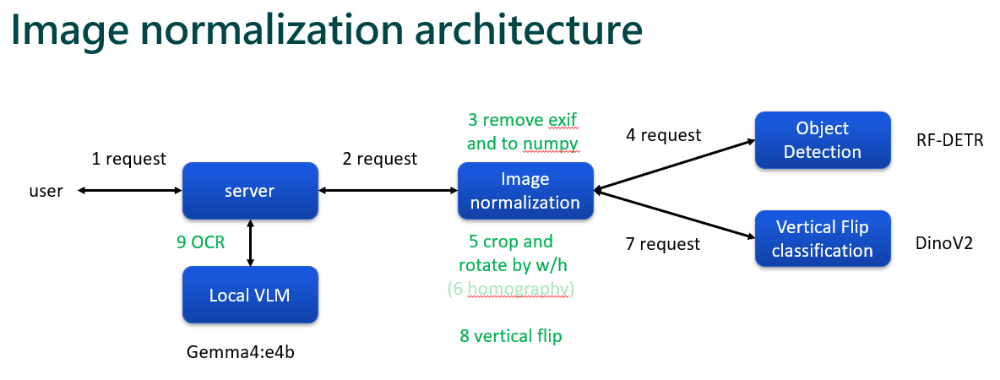

## Introduction




## Usage
1. Build docker images
    ```bash
    docker compose build
    ```

2. start
    ```bash
    docker compose  up -d
    ```

+ Send request: `image_normalization/tests/integration/test_serve.py`